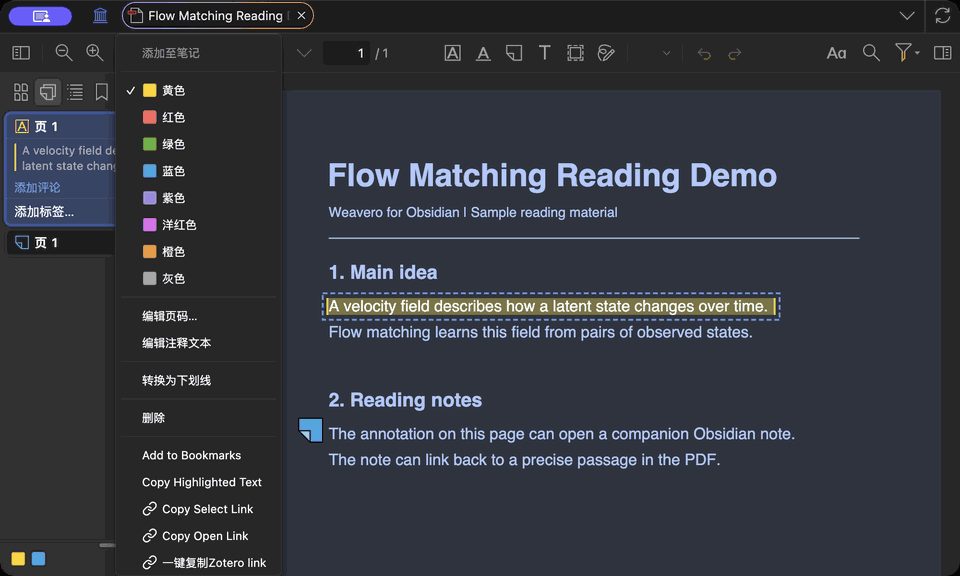
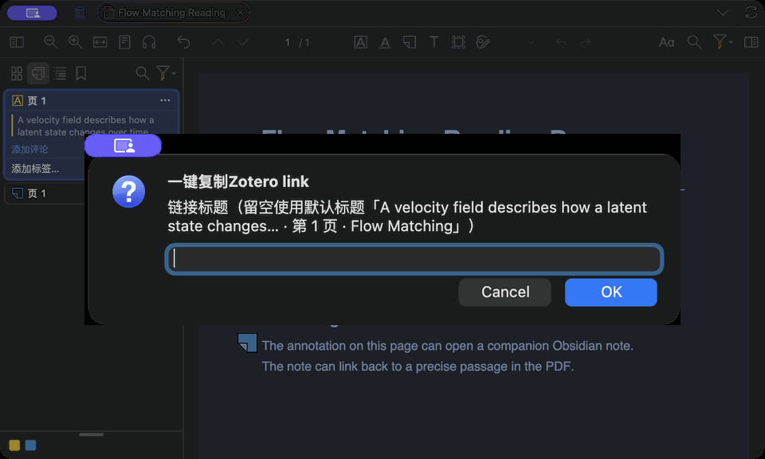
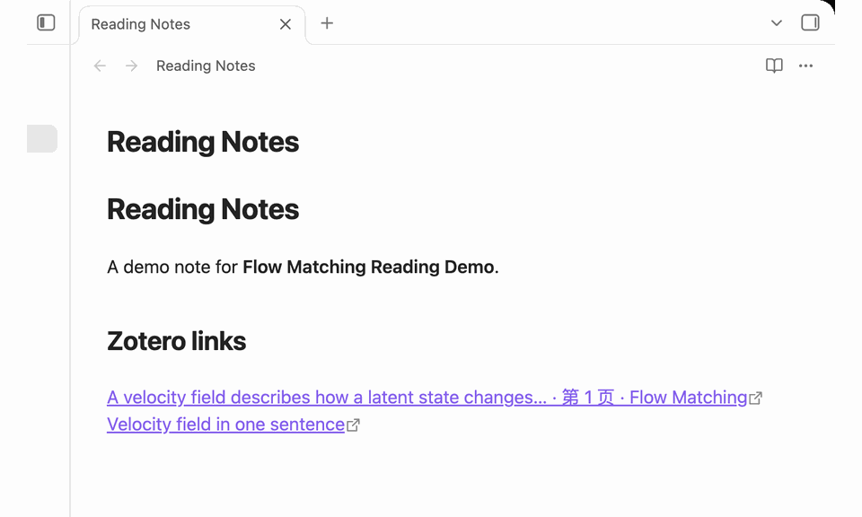

# Weavero for Obsidian

[English](README.md) · 简体中文

在 Zotero PDF 的页码、选区、批注与 Obsidian 阅读笔记之间双向跳转。本项目基于 mjthoraval 及贡献者的 [Weavero v1.1.0](https://github.com/mjthoraval/Weavero/tree/v1.1.0) 开发。

## 安装

1. 使用 Zotero 9 或 10 桌面版。
2. 在「工具 → 插件」中，先停用原版 Weavero 或此前的个人测试版。两个版本共用 Weavero 设置和阅读器集成。
3. 下载 [weavero-obsidian.xpi](https://github.com/zhibird/Weavero/releases/latest/download/weavero-obsidian.xpi)，拖进插件窗口，或选择 **Install Plugin From File…**。
4. 在「设置 → Weavero → Links & Relations」中选择 **Inline**，开启 **App links**，再在 **App Link Schemes** 中开启 **obsidian://**。

## 把 Zotero 链接放进 Obsidian

在 PDF 空白处、文字选区或批注上点右键，也可以用批注卡片的三点菜单。选择 **一键复制Zotero link**。

- **默认标题**。标题留空时，每条链接会用选中文字或批注摘要、页码和论文短标题。空白处会用页码，有定位点时会加入位置。
- **自定义标题**。输入想在 Obsidian 里看到的标题。多选批注时，输入的标题会应用到每条链接。

把复制的 Markdown 粘进笔记。在阅读视图点链接即可跳回 PDF。精准选区和定位点使用 Weavero 的阅读器集成，标准页码和批注链接由 Zotero 直接打开。

## 从 Zotero 打开 Obsidian 笔记

在 Obsidian 命令面板执行「复制 Obsidian URI」，把地址直接粘进 Zotero 批注评论。退出编辑后会显示紫色的 **跳转到obsidian**。点它即可打开对应笔记。也可以用 Markdown 自定义显示文字，例如 `[阅读笔记](obsidian://open?vault=Demo&file=Reading%20Notes)`。

## 实机演示

在 macOS 上使用 Zotero 11 Beta、Obsidian 1.15.1 和独立示例文库录制。v1.1.1 安装包声明支持 Zotero 9 和 10。

### 留空使用默认标题

标题留空，复制后直接粘进 Obsidian。链接文字包含选区摘要、页码和论文短标题。最后一帧展示用同一条链接在独立 Zotero 实例中打开并定位到原高亮。

### 输入自定义标题

在对话框里输入想在笔记中看到的链接标题，再粘贴到笔记。

### 从 Zotero 批注打开 Obsidian 笔记

把笔记 URI 粘到批注评论，退出编辑后点紫色链接。

## 源码与许可证

本项目使用 [AGPL-3.0](LICENSE)。原版的过滤器、书签和阅读器功能见 [上游文档](https://github.com/mjthoraval/Weavero/tree/v1.1.0)。本版本的安装包见 [GitHub Releases](https://github.com/zhibird/Weavero/releases)。
